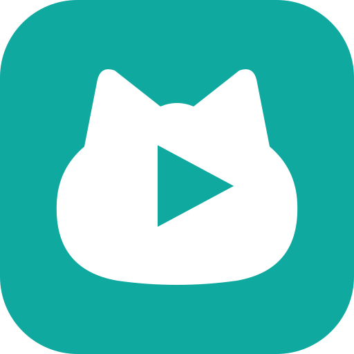

<p align="center">
  
</p>

<p align="center">
  <a href="https://upchr.github.io/meow/">文档站</a>
  ·
  <a href="https://github.com/upchr/meow/releases">下载</a>
  ·
  <a href="docs/00-目录索引.md">技术文档</a>
</p>

# 猫窝 Meow

跨端影视客户端：**Web / PC / TV 一套内核，三个出口**。

同一套 JVM 宿主 + 同一份 spider jar，同时服务浏览器、Windows 桌面端和 Android TV。
后端负责加载第三方内容源、聚合搜索、弹幕聚合与代理播放；三端共用同一份 Vue 前端。

> **本项目不提供任何内容源，用户自行承担合规责任。**
> 影视内容、站点配置与弹幕数据均来自第三方，由用户自行导入；本项目只提供播放与加载能力。

```
Web  ─┐
PC   ─┼─→ 同一个 JVM 宿主 + 同一份 spider jar + 同一套配置语义
TV   ─┘
```

版本号见 [`client/package.json`](client/package.json)。

---

## 项目背景

内容源（spider）以 jar 形式由第三方分发，每个平台原本都要各写一套加载器。
这个项目把「宿主」抽出来做一次，三端复用：

| 端 | 后端在哪 | 怎么加载 spider |
|---|---|---|
| **Web** | Docker 容器内（独立 apiserver 服务） | JVM `classpath`（`Class.forName`） |
| **PC** | 随应用启动的 sidecar 进程 | 同上 |
| **TV** | 无（客户端自己执行） | `DexClassLoader` |

> **spider jar 与站点配置由「源包（Source Pack）」提供，仓库不附带。**
> - **统一入口**：`config.all.json`，顶层 `spider` 指向 **CatVod dex jar**
>   （ZIP 内含 `classes.dex`，URL 带 `;md5;<32位>`）。
> - **Fongmi / TVBox / 猫窝 TV**：直接加载这份 dex；站点不写 `jar` 时回退顶层
>   `spider`，不需要为每个 `csp_` 站重复写 jar。
> - **猫窝 JVM**（Docker / PC / 自建后端）：同一份配置直接导入；没有 `spiderJvm`
>   时由导入期 `Dex2Jvm` 自动把 dex 转成 class 并缓存。`spiderJvm` 是可选的
>   JVM 优化/旧版兼容字段，不是必需产物。
> - 规则、校验脚本与 OECT 源服务部署见 [`deploy/source-pack/`](deploy/source-pack/README.md)
>   和 [`deploy/SOURCE_PACK.md`](deploy/SOURCE_PACK.md)。
> - 导入入口：Web/PC 设置 →「配置源」；TV 设置 →「本机执行」→ 配置地址；
>   手机扫码可把**后端地址 + 配置地址**推给 TV（走后端模式）。
> - 源包放在私有 Release / NAS / 对象存储即可，仓库只保留加载器、示例配置和构建脚本。
> - **PC 安装包与公开 Release 都不内置源包**：装完是空壳，导入源包后恢复 jar 站。

### 可以导入的源

本项目不自带源，但支持导入生态里常见的几种形态——CatVod / TVBox / Fongmi 系的 spider jar、drpy 脚本、苹果CMS 配置等：

| 形态 | 加载方式 |
|---|---|
| CatVod spider jar（`csp_*`） | JVM `Class.forName` / TV `DexClassLoader` |
| drpy `.js` | `server/drpy` 外挂 Node 运行时 |
| 苹果CMS 直连（`type: 1`） | 按 CMS 协议直接拉取 |
| 多仓索引（`{"urls":[...]}`） | 导入时逐个探测仓库是否可用 |
| `/config.json` | CatVod 出口配置，可导入站点/直播/解析表 |

源由用户自行准备；仓库不附带任何站点配置、spider jar 或第三方令牌。

---

## 仓库结构

```
meow/
├── client/          前端 + 桌面壳 + TV 壳
│   ├── apps/web/       Vue 3 + TypeScript + Vite + Tailwind v4
│   ├── apps/desktop/   Tauri 2 壳
│   ├── apps/tv/        Android WebView 壳 + 端上 ExoPlayer + 本地 jar 执行
│   └── brand/          图标单一源（SVG）+ 生成脚本
├── server/          后端宿主
│   ├── host/src/       ApiServer.java + routes/ + 51 个 android.* stub + core/
│   ├── host/libs/      10 个公开依赖 jar（spider.jar 需自备/源包导入）
│   ├── drpy/           drpy 外挂 Node 运行时（打成插件）
│   ├── plugin-manifests/  插件清单模板
│   └── build-plugin*.ps1  插件构建（fat jar + jlink JRE）
├── site/docs/dev/   架构/契约/前端/TV/插件/部署等技术文档（与文档站共用）
├── deploy/          部署与发版（Dockerfile ×3 + compose ×2 + 脚本）
└── data/            运行时数据（apiserver 与 danmu 各自挂载）
```

`node_modules/`、`build/`、`data/` 等本地产物不入库。

---

## 功能现状

当前版本 1.1.5 的实际能力：

| 模块 | 能力 |
|---|---|
| 浏览与搜索 | 首页推荐、分类分页、详情、聚合搜索（自适应预算 / 失效跳过 / 结果缓存）、搜索历史、收藏与追剧更新 |
| 播放 | HLS/DASH、`parse=1` 解析、手动/自动换线、续播、0.5–3x 倍速、片头尾与中插跳过、选集连播、字幕（SRT/ASS/HLS 内嵌）、画中画、DLNA 投屏、假死与 404 看门狗 |
| 弹幕 | 多源降级（顺序可配）、手动搜索、屏蔽/密度/透明度/字号/速度、本地缓存、canvas 60fps、片尾预取 |
| 直播 | 站点聚合 + IPTV m3u/txt、换台、坏台自动跳、左右切线路 |
| 片库与缓存 | WebDAV / 本地 / SMB 片库，Range 直连，按需转 HLS，海报刮削；单集/整季离线缓存、断点续传、离线优先 |
| 跨端状态 | 收藏/进度/历史/观看统计/偏好跨端通道；WebDAV 同步与备份（快照式，非实时） |
| 源与配置 | 多仓配置导入（探测 + 自动备份）、站点健康/停用/批量管理、安全 DNS/DoH、drpy JS 运行时 |
| 设置与 AI | 外观/网络/弹幕/播放/搜索/数据维护；AI 助手（规则 + 语义工具 + 模型层） |
| 三端形态 | Web 四容器；PC 插件化 + 内置 MCP + 在线更新；TV 端内网关 41 路由 + DexClassLoader + 遥控导航 + 扫码配置 + 远程调试 |

已知限制：

- **源站时效**：不少源的播放地址绑定客户端 IP 且几分钟过期
- **线路存活**：上游源经常整条失效，需要手动换线路
- **需要浏览器解析（type 0）的源**：后端没有 WebView，Web 端不支持
- **多画质**：只在播放失败页给「换个画质」出口，没有常驻选择器
- **投影仪（Android 9 / armeabi-v7a）**：聚合搜索仍会把进程打崩，未修

---

## 参考项目

以下项目只作协议、契约与交互参考，不作为运行时依赖：

| 项目 | 参考了什么 |
|---|---|
| [Fongmi/TV](https://github.com/Fongmi/TV) | TV 端契约：`/config.json` 九字段、`spider;md5` 语义、`ParseJob` 五种解析、`Site` 三态开关 |
| [Fongmi/CatVodSpider](https://github.com/Fongmi/CatVodSpider) | spider jar 的 class 结构与 `Class.forName` 动态加载模型 |
| [huangxd-/danmu_api](https://github.com/huangxd-/danmu_api) | 弹幕聚合协议、`SOURCE_ORDER`、两段式（候选 JSON → XML） |
| [motao123/webtv](https://github.com/motao123/webtv) | Android 客户端的源管理、直播、drpy 支持机制对照 |
| [xyoye/DanDanPlayForAndroid](https://github.com/xyoye/DanDanPlayForAndroid) | 弹幕轨道调度与密度控制的交互参考 |
| [l429609201/misaka_danmu_server](https://github.com/l429609201/misaka_danmu_server) | 弹幕服务协议差异对比 |
| [LibreSpark/LibreTV](https://github.com/LibreSpark/LibreTV) | 选线规则、季数感知相关性过滤、SSRF 归一化的思路（自己重写） |
| [MoonTechLab/LunaTV](https://github.com/MoonTechLab/LunaTV) | 用户态存储接口化的思路（自己重写） |
| [orion-lib/OrionTV](https://github.com/orion-lib/OrionTV) | TV 返回键三层语义、长按连发、控制条显示时屏蔽方向键 |

> 这些项目只在私有开发环境作为只读参考，公开库不包含其源码。

---

## 启动方式

> 启动后需要在设置页导入你自己的源配置；本项目不自带任何源。

### Web（Docker，四个容器）

**直接用发布镜像**（推荐，不需要源码）：

```bash
cd deploy/docker
cp .env.example .env
docker compose up -d
# 浏览器打开 http://localhost:30010
```

**从源码构建**：

```bash
cd deploy/docker && docker compose -f docker-compose.build.yml up -d --build
```

| 容器 | 内容 | 端口 |
|---|---|---|
| `web` | nginx + 静态文件（**不含 JVM**） | 30010 |
| `apiserver` | JVM + spider jar + ffmpeg（**不含 nginx**） | 30011（默认只绑本机） |
| `drpy` | Node 运行时，跑 `.js`/drpy 源 | 30013 |
| `danmu_api` | 弹幕聚合（可选） | 30012（默认只绑本机） |

`web` 与 `apiserver` 都含 **amd64 + arm64**，Docker 按本机架构自动选。
`drpy` 不建议省：导入 270 站配置时，222 个 drpy 站没有它会被判"不可用"。

按需组合：

```bash
docker compose up -d                             # 四个都起
docker compose up -d apiserver drpy danmu_api    # 只起后端（给 TV / 别的客户端）
docker compose up -d web                         # 只起前端（连远端后端）
```

只想起前端连别的后端：`.env` 里改 `MEOW_APISERVER=http://192.0.2.10:30011` 再 `up -d web`。

### PC

需要 Rust + MinGW（不需要 MSVC）：

```bash
rustup toolchain install stable-x86_64-pc-windows-gnu
winget install BrechtSanders.WinLibs.POSIX.UCRT

cd client && pnpm install
cd apps/desktop
powershell -ExecutionPolicy Bypass -File ./build-gnu.ps1 --bundles nsis
```

产物：`client/apps/desktop/src-tauri/target/x86_64-pc-windows-gnu/release/bundle/nsis/`

> 打包前必须先构建后端插件（`server/build-plugin.ps1`），
> `tauri.conf.json` 的 `bundle.resources` 指向 `server/build/plugins/apiserver/*`。

### 本地开发

```bash
# 后端（两个终端之一）
cd server && powershell -ExecutionPolicy Bypass -File ./build-plugin.ps1
# 或快速版：
cd server/host && ./build.bat && ./start-api.bat      # → 127.0.0.1:9979

# 前端热更新
cd client && pnpm install && pnpm dev                 # → localhost:5173
```

Vite 已把 `/api` 代理到 `127.0.0.1:9979`，浏览器里没有跨域问题。

---

## 许可

本项目采用自定义的[「猫窝 Meow 非商业许可 1.0」](LICENSE)：允许个人学习、研究、自用与修改，
**不允许任何商业使用**。这不是 OSI 认可的开源许可证，属于「源码可见」（source-available）。

本项目不提供任何内容源，用户自行承担合规责任。
